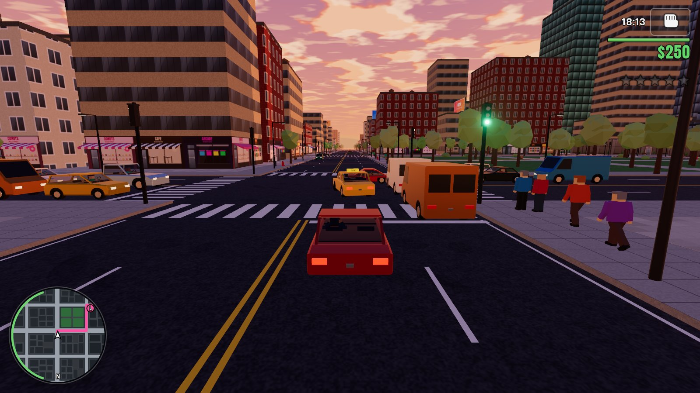
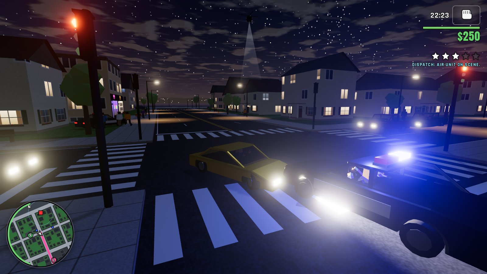
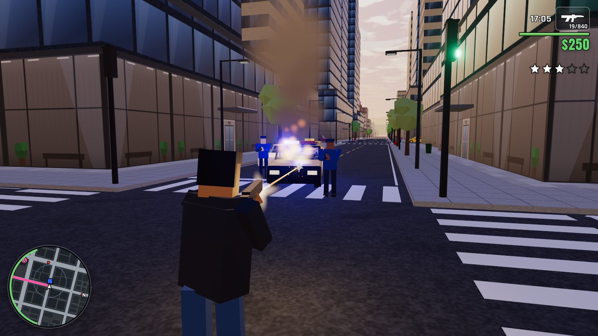
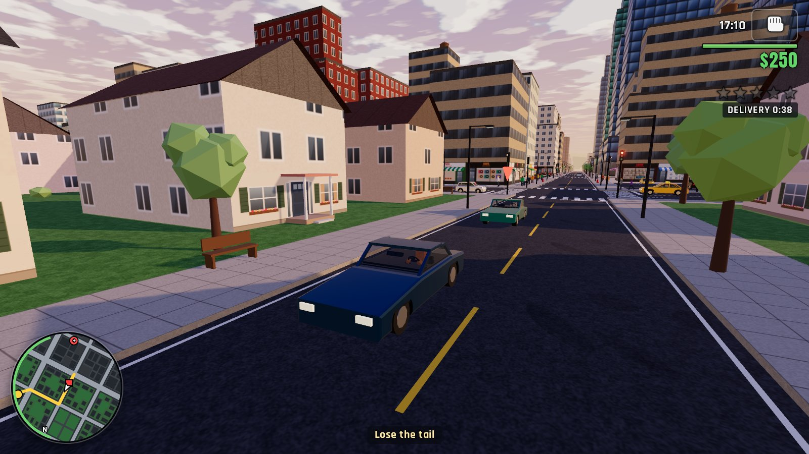
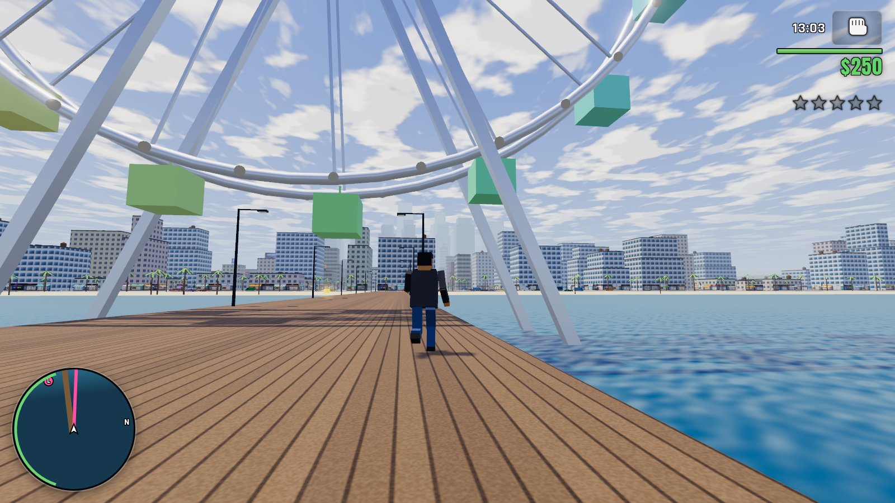
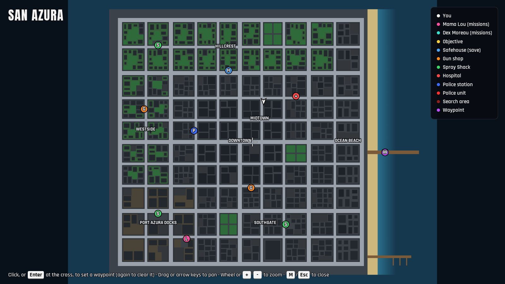

# GTA 7: Grand Turbo Anarchy

An original, GTA-style open-world crime sandbox that runs entirely in the browser.
Steal cars, cause chaos, outrun the cops, and work your way up from a broke ex-con to the top of **San Azura**, a sun-bleached fictional coastal city.

Everything is generated at runtime: the city, the buildings, the cars, the people, every texture, every sound effect and three radio stations of procedural music.
There are no downloaded images, models or audio files; the only bundled assets are two fonts.

> Fan-made parody.
> Not affiliated with or endorsed by Rockstar Games or Take-Two Interactive.
> All characters, places, vehicles and brands are fictional.



## Quick start

**Play it now in your browser: https://tengs-fan.github.io/gta7/** (Chrome or Edge, with a keyboard and mouse or a gamepad).
To run it yourself:

Requirements: Node.js 22.12 or newer within 22.x, 24.x or 26+ (the range Vitest 5 supports; 23 and 25 are not), a browser with WebGL 2 and hardware acceleration, and a keyboard and mouse or a gamepad: there are no touch controls.
The game is tested in Chromium, so Chrome and Edge are the safe choice; Firefox and Safari should work but are not tested automatically.

```sh
npm install
npm run dev        # http://localhost:5173
```

Production build:

```sh
npm run build      # type-checks, then bundles to dist/
npm run preview    # serves dist/ at http://localhost:4173
```

`dist/` is a static site with relative paths, so it can be hosted anywhere, under a sub-path too.

Choose NEW GAME on the title screen, and a few seconds later Mama Lou calls with your first job: steal a car (walk up to one and press F) and drive it into her garage in the Docks, following the route on the radar.
Progress stays in this browser: the game autosaves after every mission passed, E at the safehouse saves, and CONTINUE on the title screen picks up from there.

## Controls

| Action | Keyboard and mouse | Gamepad |
| --- | --- | --- |
| Move / steer | W A S D or the arrow keys | Left stick |
| Look (in a vehicle it orbits the camera) | Mouse | Right stick |
| Sprint (on foot) | Shift | A |
| Jump (on foot) | Space | X |
| Shoot / punch (on foot) | Left click | RT |
| Aim (on foot) | Right click | LT |
| Reload (on foot) | R | B |
| Choose a weapon | 1–6, mouse wheel, Q (previous) | LB / RB on foot, LB in a vehicle |
| Accelerate / brake and reverse (vehicle) | W or Up / S or Down | RT / LT |
| Handbrake (vehicle) | Space | RB or A |
| Shoot from a vehicle (pistol or SMG) | Left click | X |
| Horn, or siren in a police vehicle | E or H | L3 |
| Radio next / previous (vehicle) | R / Q | D-pad right / left |
| Enter / exit vehicle (also carjacks) | F or Enter | Y |
| Interact: missions, shop, save, retry, skip dialogue | E | D-pad up |
| Taxi / vigilante job (in a taxi or police vehicle) | T | D-pad down |
| Camera distance | V | R3 |
| Map | M | Back |
| Pause | Esc or P | Start |
| Menus | W S or Up Down choose, A D or Left Right adjust, Enter or Space confirm, Esc or Backspace back | D-pad or left stick choose and adjust, A confirm, B back |

- Keys are matched by position and named here as on a US QWERTY keyboard.
  In the game, prompts and the CONTROLS screen show the names printed on your own layout, so on AZERTY you move with Z Q S D; Firefox and Safari learn the layout as you press keys.
- The game captures the mouse when you start or resume play, or when you click the game view.
  Mouse look works only while it is captured, and losing it (Esc) pauses the game, as does switching to another tab.
- Weapon slots: 1 Fists, 2 Pistol, 3 SMG, 4 Shotgun, 5 Assault Rifle, 6 Rocket Launcher.
  The wheel, Q and LB / RB step through the weapons you own that still have ammo; in a vehicle only the pistol and SMG fire, Q changes the station, and on a gamepad LB steps the weapons (RB is the handbrake).
- Getting out of a moving car: below 3.5 m/s you step out, up to 11 m/s the car brakes first, and faster than that you bail out, tumble and lose 6 health.
- Map: click, or press Enter, Space or A at the center cross, to set a waypoint, and do it again on the waypoint to clear it.
  Drag, the arrow keys, W A S D, the D-pad or the left stick pan; the wheel, + and -, or LB and RB zoom; M, Esc or Back close it.
  The game is paused while the map is open.
- Gamepads: the first pad the browser reports with the standard mapping is used.
  Buttons are named Xbox-style, and prompts switch to pad buttons as soon as you use the pad, and back to keys when you press a key.

## What's in the game

- **A whole city.** San Azura is ten by ten blocks across seven districts (Downtown towers, Midtown, the Hillcrest suburbs, Westside, Port Azura Docks, Southgate and the Ocean Beach strip) and three parks, with the Azura Bowl stadium, Azura Pier and its Ferris wheel, the Marina, a lighthouse, and the cranes and containers of the docks.
  Parody shopfronts (DONUTS, PAWN, TACOS, BAIL BONDS and more), tower lobbies and house porches line the streets, and lamp posts, traffic signals, fire hydrants, bins and benches break.
- **Day and night.** A day lasts 24 minutes.
  Clouds catch the sunset, a moon and stars come out, windows light up building by building through the evening and thin out after midnight, and at night the Ferris wheel lights up and the lighthouse beam sweeps round.
- **Living streets.** Traffic follows its lanes, stops at red lights, yields on left turns, honks, overtakes and backs out of blockages, from about 14 cars around you late at night to 30 at rush hour.
  Pedestrians cross on the walk signal, flee from gunfire and explosions, put their hands up, cower or run at gunpoint, and some fight back, above all the Tiburones gang, who wear teal, often carry pistols and fight as a crew on their own turf.
- **Driving.** Ten vehicles: the Pipsqueak compact, Velora sedan, Azura Cab, Nightjar GT sports car, Thunderhoof muscle car, Dustrunner pickup, Breadbox van, Citybus, Patrol Cruiser and Riot Van, and you can steal any of them, even with someone inside.
  Arcade handling with handbrake drifts, skid marks and tire smoke; cars dent, lose their lamps and glass, spark along walls, catch fire when they land on their roof and blow up, and you can see who is inside through the glass.
  Cars wade through the surf off the beach but sink in deep water, and Azura Pier and the Marina deck can be driven onto, and off.
  Five stunt ramps pay stunt bonuses, doubled for the first jump off each one.
- **On foot and in the water.** Walk, sprint and jump (long falls hurt), and swim in deep water: there is no drowning, but no shooting, weapon switching or getting into cars either.
- **Combat.** Fists, Pistol, SMG, Shotgun, Assault Rifle and Rocket Launcher.
  Hip fire is quick and loose, while aiming zooms over the shoulder and tightens the spread; hit markers show hits, headshots and kills, and red arcs show where fire is coming from.
  Body armor, jab-jab-hook punch combos, drive-bys with the pistol or SMG, and explosions that throw people and cars and set off damaged or light cars nearby.
  The dead drop their cash, and the police helicopter can be shot down.
- **Wanted level.** Five stars.
  Crimes like carjacking, assault and gunfire count only when the police see them, and so does killing a gang member or an armed mission guard, while murdering anyone else, attacks on the police and explosions are always reported.
  Patrol cars, pursuit units that from two stars cut you off from ahead and shoot from their windows, SWAT Riot Vans from four stars, and a helicopter from three that loses you behind buildings and at night sees little beyond its spotlight.
  Officers arrest you when they reach you on foot while you are not running, or beside your car once it has stopped, and from two stars they shoot on sight (at any level once you attack one of them); a DISPATCH line on the HUD narrates the chase.
  To lose them, break line of sight and get out of the red search area on the radar (or hide inside it for longer) until the evade bar fills, or pay a Spray Shack $100 a star for a respray, if the police don't see you drive in.
  BUSTED costs bail ($100 plus $150 a star) and, from two stars, your guns; WASTED costs a hospital bill ($100 plus $100 a star) and your armor.
- **Story.** You are Kai Navarro, just out after six years inside, and a new game opens with a call from Mama Lou.
  Six missions: Wheels, Hot Delivery and Repo Man for Lou, then Loose Lips, Heatwave and The Big Score for Dex Moreau, the last a raid on the First Azura Bank with a getaway to the Marina; Hot Delivery, Repo Man and Heatwave pit you against the Tiburones.
  The contacts are the pink L and the teal D on the radar, shown while they have a job for you; a failed mission can be retried with E within 20 seconds, and Heatwave and The Big Score have checkpoints.
- **Side content.** Taxi fares in an Azura Cab and vigilante jobs in a police vehicle (press T), three gang rampages, twenty hidden packages ($25,000 for finding them all), unique stunt jumps, health, armor and weapon pickups, and two Bang Bang Guns stores (from the Pistol at $250 to the Rocket Launcher at $8,000, Body Armor $300, First Aid $80).
- **Radio and sound.** In a vehicle, NEON DRIVE 88.7 (synthwave), BOOM BAP 101.3 (hip-hop) and PULSE 96.1 (house) play endless music generated live, with RADIO OFF as the fourth stop.
  An ambience of city hum, traffic, surf, gulls, birds by day and crickets at night, an engine voice for every kind of vehicle, music that ducks under dialogue and nearby explosions, and the world muffled inside a car.
- **HUD, map and saves.** A radar that turns with the camera, with a road-following GPS route to your waypoint, the objective or the contact who has work, and the police, the helicopter and the search area on the radar and the map while you are wanted.
  Prompts and first-time hints drawn for your keyboard layout or gamepad, a full-screen map with district names, a legend and a waypoint you can set, and a STATS screen with a game completion percentage.
  One save slot in the browser: save at the safehouse with E (not while wanted, on a mission or on a rampage), plus an autosave after every mission passed.

<table>
  <tr>
    <td width="50%" valign="top"><br>Three stars after dark in Hillcrest, with the helicopter's searchlight closing in.</td>
    <td width="50%" valign="top"><br>An assault rifle against a burning Patrol Cruiser in Downtown.</td>
  </tr>
  <tr>
    <td width="50%" valign="top"><br>Hot Delivery: shaking off a Tiburones car with the DELIVERY clock running.</td>
    <td width="50%" valign="top"><br>Azura Pier and its Ferris wheel, with Ocean Beach and the skyline behind.</td>
  </tr>
  <tr>
    <td colspan="2" align="center"><br>The full-screen map, with a waypoint set on Azura Pier.</td>
  </tr>
</table>

## Cheats

Type a code during play: no Enter, any mix of upper and lower case, each letter within 1.5 seconds of the one before.
A message confirms it ("Cheat activated", or "Cheat: god mode on" and "Cheat: god mode off" for IMMORTAL).
The first letters of a code may briefly do their usual job (M opens the map, F gets you out of your car), and the game undoes that once the code is complete.

| Code | Effect |
| --- | --- |
| `CHILLOUT` | Clears the wanted level, but not below the stars a mission fixes (the bank alarm in The Big Score) |
| `GUNSGALORE` | Gives you the Pistol, SMG, Shotgun, Assault Rifle and Rocket Launcher if you lack them and adds 300 rounds to each, every time you type it |
| `FIXMYRIDE` | Repairs the vehicle you are in or, on foot, the nearest one within 30 m that you were the last to drive: full health, fire out, back on its wheels |
| `IMMORTAL` | God mode on or off: no damage to you, or to your vehicle while you drive it; you can still be BUSTED |
| `MONEYTREE` | Adds $50,000 |
| `SUNSET` | Sets the clock to 18:18 |
| `NIGHTOWL` | Sets the clock to 23:00 |
| `SPAWNSPORTS` | An empty Nightjar GT about 6 m ahead of you, if there is room for one within 20 m |
| `COPMAGNET` | Two more wanted stars, up to five |

## Settings and graphics quality

SETTINGS is on the title screen and in the pause menu.
Changes apply at once and are stored in the browser (`localStorage` key `gta7.settings.v1`); the one save slot is `gta7.save.v1`.

| Setting | Range | Default |
| --- | --- | --- |
| Graphics quality | Auto, Low, Medium, High | Auto |
| Master volume, Music (radio), Sound effects | 0–100% each | 80%, 60%, 85% |
| Mouse sensitivity (the right stick too) | 0.20–3.00 | 1.00 |
| Field of view (wider at speed in a vehicle, narrower when aiming) | 55–90° | 68° |
| Invert look Y (mouse and right stick) | On / Off | Off |
| Tutorial hints (first-time hints and the "Press F to steal" prompt) | On / Off | On |
| DELETE SAVE | asks first | |

**Auto** picks a tier once per page load from the GPU, and the row shows its choice, such as AUTO (HIGH).
It picks High on discrete GPUs (laptop ones included) and on Apple M-series Pro, Max and Ultra chips, Medium on other integrated GPUs (GeForce MX laptop chips count as integrated), on phone and tablet GPUs and on any GPU it does not recognize, and Low on software renderers and on integrated GPUs driving very large screens (where Medium would draw more than 3.5 million pixels, such as 3440x1440, or 3840x2160 at 100% scaling).

| | High | Medium | Low |
| --- | --- | --- | --- |
| Resolution | full, pixel ratio up to 1.5 | 85%, high-DPI ignored | 67%, high-DPI ignored |
| Anti-aliasing | 4x MSAA | 4x MSAA | off |
| Sun shadows | 2048 map | 1024 map | off |
| Bloom | on | on | off |
| Dynamic lights (sirens, muzzle flashes, explosions) | all | two, shared | none |
| Your headlight beam at night | on | on | off |
| Traffic and pedestrians | 100% | 90% | 75% |
| Ambient cars drawn | all | all | within 150 m |

Colors are the same on every tier; Low loses the glow, the shadows and some of the sky's detail.
Everything applies at once except anti-aliasing, which changes after a reload (the Settings screen says so).
A lower tier's traffic and pedestrian numbers take effect as cars and people come and go: nobody is removed on the spot.

If the graphics driver resets, the game pauses behind "Graphics reset - restoring..." and returns to the pause menu once WebGL is back; choose RESUME to carry on.
If it has not come back after 10 seconds, the notice offers RELOAD.

## Known issues

All of these are minor; the most noticeable come first.

**Camera**

- With your back against a wall, your character fades out (fully, or to a speckled ghost) because the camera has no room behind you; step about a meter away.
- On foot the camera does not avoid vehicles, so with your back close to a bus or van it can end up on the far side, with the bodywork hiding you; step away or turn the camera.
- Brushing past a street tree on foot, its trunk can hang in view for about half a second before the camera jumps in front of it.
- Aiming while standing in a save, shop or mission marker puts the marker's floating diamond big in front of the camera; step out of the marker first.
- Swimming a couple of meters off a quay or a Marina pier, swinging the camera over the edge makes it hop up in one frame; right against a pier a fast swing with the far camera (V) can make it jump for a frame, and near the edge a wall, a crane leg or a change of camera distance can make it dive in toward you and back out.

**Traffic and driving**

- In big police chases, police cars sometimes jam against each other or traffic at a junction and sit stuck for a while.
- Traffic cannot squeeze between two cars left less than about a car and a half apart on opposite sides of a narrow street, and queues there honking while you stay nearby; move one of the cars or drive off.
- When a car overtaking one left in the road meets oncoming traffic, the drivers can spend half a minute or more backing up and taking turns.
- City buses turning at the four outer corners of the ring road crawl round the bend and swing into the oncoming lanes for a couple of seconds.
- Getting into a bus from its front or back makes your character walk into the bodywork and pop into the seat; walk up to the middle of its driver's side instead.
- A car that lands a jump on top of another car does not settle on its roof: both cars snap about a meter sideways in a single frame, undamaged.
- A car or wreck that spins into the tall back corner of a stunt ramp can come to rest with the corner sticking into its side.
- A car or bus sliding slowly off the side of the pier shows part of its body poking up through the deck for a second or two as it falls in, and a car resting half inside the edge of the pier or the Marina deck can be shoved or steered about twice as deep into it, though it still drives away.
- Near the land end of Azura Pier or the Marina deck, getting out of a car on the side that faces the edge can drop you about a meter onto the sand, where you cannot climb back up (walk round to the land end), and a wreck sunk under the deck can block getting out of a car parked above it ("No room to get out here") until you drive off.
- Pressing F within a couple of meters of a car on the other side of a wall (Lou's garage, say) walks you straight through the wall into it.
- Now and then a new city bus appears slightly overlapping the bus ahead of it in the same lane, usually out of sight, and both end up dented.

<details><summary>More, by area</summary>

**Police, combat and people**

- After a police stop that ends calmly, the officer who got out on the passenger side can grind against his cruiser's side for about half a minute, unable to get back in, and is then left behind when it drives off.
- A rocket fired at the sea flies on under the surface and blows up far out with no splash, yet still earns a wanted star, and bullets fired at the water likewise end under the surface.
- At two stars or more, standing still on top of a stunt ramp to be arrested does not work: no officer climbs up, and about 45 seconds after they arrive they shoot you dead; come down off the ramp first.
- If a car you left behind kills a pedestrian, either because another vehicle smashed it into them or because it was still rolling after you bailed out and died, the death can be pinned on you, with a wanted star, even when you are far away.
- In a rampage, gang members' stray shots sometimes kill their own crew, and those kills don't count, but new gang members keep coming.
- With an enemy right at your right shoulder, an aimed pistol shot at his head or neck can miss; aim at his chest, fire from the hip or step back.
- Shots at the head and shoulders of someone who has been knocked down or killed pass straight through, though the hips and legs still register.
- An enemy firing an SMG, rifle or shotgun from a step or two away keeps his gun slightly to one side of you and jerks it onto you with each shot.
- People who flee onto the narrow Marina piers walk off the side into the sea, and some stay paddling against a pier or a moored boat; on the beach beside a pier or the Marina deck a fleeing person can get boxed in and stand frozen for up to about ten seconds.
- When a car with people in it sinks in deep water, they vanish on the spot instead of swimming or dying, and nothing is counted as a kill or a crime.
- Stunt ramps look solid, but bullets, officers' line of sight and explosions pass straight through them.
- While you climb into a car (about half a second, longer for a carjack or a bus) you cannot be shot or run over: bullets and cars pass through you until you are seated.
- At one star, an officer who ends up in the sea while you are swimming treads water until you leave it; swimming away still loses the star.
- Officers on a pier cannot get back to a cruiser standing in the surf beside it: while you are wanted they pace back and forth at the pier's land end, and once you are not they give up and leave the car sitting dark in the water.
- A police helicopter shot down over a garage (Lou's, for one) falls through the roof and explodes inside among whatever is parked there, and the lighthouse, the crane legs and the Ferris wheel do not stop its fall either.
- A weapon pickup is used up even when that gun's ammo is already full: it shows "Pistol ammo." and adds nothing until it respawns.
- With the IMMORTAL cheat on, hits that do no damage still make you spray blood, which can look as if you were hurt.
- A shot aimed at you that misses can still fly on and hit an officer standing behind you.
- A gunman firing from a tight gap beside a vehicle now and then puts a stray round into it.
- A police car shoved into shallow water stays put there while you are close by.
- At one star far out on Azura Pier, officers on foot can take so long to walk out that the star clears before they reach you.

**Missions and jobs**

- Hot Delivery's package and The Big Score's bank door respond only to you on foot: if you drive onto them nothing happens and the objective stays put, with no hint; get out of the car.
- After you fail a mission, once MISSION FAILED fades, the objective line and a pink route on the radar can send you to Mama Lou ("Next: Mama Lou has work") while the prompt still says to press E to retry; retrying with E is quicker than driving to her.
- A fade to black that hides a jump (a mission retry or a car hand-over in Lou's garage, say) can run out behind the pause menu if you pause just as it starts, so you watch the jump when you resume, and it can happen the same way below about 10 fps; a Spray Shack respray also shows its new paint a moment before the screen is fully dark.
- The low-health hint suggests saving at the safehouse, but during a mission the safehouse refuses to save or heal, and the hint shows only once, so you will not see it again when its advice would work.
- Pressing E at the safehouse within a second or so of stepping out of a taxi or vigilante car can wrongly answer "You can't save during a rampage"; press E again.
- Quitting to the title on the BUSTED or WASTED screen just after passing a mission keeps the pass and its pay but skips the bail or hospital bill.

**Graphics**

- Pedestrians can pop into existence on sidewalks far down the street, in plain view, most of all in the first seconds of a new game and when you drive into new streets.
- Old wrecks and dead bodies can vanish in a single frame while you are looking straight at them from 40 to 60 meters away.
- At dawn and dusk the brightness and tint of the whole picture can take a small step every 15 seconds or so instead of shifting smoothly, on every graphics tier.
- At night, tail and brake lights stay plain red without the glow that headlights and street lamps get on High and Medium, and braking barely brightens them.
- A shot-down police helicopter tumbles out of the sky with no fire or smoke, leaving only the first puff where it was hit.
- While your car burns, your character vanishes from his seat until you get out; this shows from the side and through the windscreen, and the default chase view mostly hides it.
- On older or low-end GPUs that cannot render to high-precision buffers, paint, glass and chrome don't reflect the sky and bright lights don't glow, at any setting.
- The small porches in front of houses (deck, posts and roof) and the bank's front steps are decoration only: cars, people and bullets pass through them.
- At around 10 fps, water from a knocked-over fire hydrant comes out in separate puffs instead of a steady jet.

**Menus, input and small windows**

- When the top-right corner is crowded (armor, a job or mission status, the evade bar and the DISPATCH line), pop-up messages such as "Waypoint reached", "Cheat activated" and "Autosaved" sit on top of it for a couple of seconds, and in a 1024x768 window a title card such as TAXI DRIVER can land on the DISPATCH line.
- In small windows (about 500 px tall or 800 px wide, or less), on-screen text can overlap: MISSION PASSED over a help message or an offer card, or the objective over the district name or the radar.
- Typing a cheat with a menu open can make its first letter do its menu job (MONEYTREE typed on the map closes the map until the code is finished); type cheats during play.
- Switching to another window during the WASTED or BUSTED screen, or at any time while the mouse is not captured, does not pause the game, so the city and any mission timer keep running in the background; pause with Esc or P before you switch away.
- On Firefox and Safari with a layout that moves letters (AZERTY, Dvorak, Colemak), the CONTROLS screen and key prompts show US letters until you have pressed those keys once; prompts then correct themselves, and the CONTROLS screen does when you reopen it.
- If you open the map while holding a movement key, then press and release the opposite key, the map keeps scrolling until you let go of the first key.
- On a touchpad, a sideways two-finger swipe over the game now and then switches your weapon by one.
- On a gamepad in a vehicle, LB steps through all your weapons, including ones that cannot be fired from a car, on its way to the Pistol or SMG.
- At speed, the radar's route line starts a little behind your arrow, because the route is planned again only once a second.
- If the browser will not capture the mouse (in an embedded page, say), the camera on foot cannot be turned at all and nothing says why; open the game in its own tab.
- On the title screen, the ambient hum and wind keep playing while the tab is in the background; mute the tab.

</details>

## Architecture

It is strict TypeScript on three.js 0.186, built with Vite 8 and tested with Vitest 5 and Playwright 1.64; three.js and two Fontsource fonts are the only runtime dependencies.
The game is split into a **headless simulation** and a **presentation layer**:

```
src/
  core/        math and conventions, seeded RNG, typed event emitter, 2D SAT collision and ray tests
  world/       deterministic city generator, lane graph with signals and A*, sidewalk graph,
               static collider grid with DDA raycasts, ground height, water and zones
  sim/         the game itself: entities, player, vehicle and character physics, driver AI, traffic,
               pedestrians, wanted level, police and dispatch, combat, pickups, markers and shops,
               side activities, story missions, money, stats and the save format
  render/      three.js views that mirror the sim each frame: city, props, sky and ocean, vehicles,
               instanced crowd with a planted-foot gait, particles, markers, cameras, quality tiers
  ui/          HUD and radar, menus and the full-screen map, first-time hints, key and button glyphs
  input/       keyboard with layout-aware key names, mouse with pointer lock, gamepad, cheat codes
  audio/       synthesized effects, mixer and ducking, ambience, engine voices, procedural radio
  game.ts      frame loop, title and play modes, menus, cheats, crash screen, context-loss notice
  main.ts      boot, WebGL 2 check, fonts, error hooks
  settings.ts  settings and the save slot in localStorage
  debug.ts     window.__gta7, the console and test API (in every build)
```

`src/core`, `src/world` and `src/sim` never touch the DOM, WebGL, audio, storage or three.js, so the whole simulation runs in Node.
The layers only import downwards: `core` ← `world` ← `sim` ← `render`, `audio`, `input` ← `ui` ← `game.ts`.
`Sim.update(dt, input)` clamps a frame to 0.1 s and runs every system in a fixed order, with physics in substeps of at most 1/120 s.
Missions are generator scripts resumed synchronously inside `Sim.update`, and all randomness in the sim comes from a seeded RNG, so a run from the same seed and inputs repeats exactly; the game itself passes no seed, so San Azura is the same city in every game.
The renderer, HUD and audio subscribe to the typed events in `src/sim/events.ts` (shots, explosions, impacts, messages) and read entity state each frame.
Conventions: +X is east, +Z south and +Y up, and heading h faces (sin h, cos h).

## Testing

```sh
npm run typecheck                  # tsc --noEmit, strict
npm test                           # unit tests in Node (Vitest); npm run test:watch to watch
npx playwright install chromium    # once, before the first end-to-end run
npm run test:e2e                   # end-to-end tests in Chromium (Playwright)
npm run check                      # typecheck + unit + build + e2e
```

### Unit tests

52 files with 1263 tests run in Node, with no browser.
They cover collision math, world invariants, physics, driver AI, pedestrians, combat, the wanted level and the police, every story mission completed by a scripted bot with its failure paths and retries, side jobs, saves, and a 10-minute chaotic soak test (36,000 frames with a seeded random player).
The renderer, crowd, HUD, menus, input, audio and `Game` flows run against small in-file fakes (canvas, WebGL renderer, Web Audio, `localStorage`), and one file even runs the particle and skid-mark shaders through a small GLSL interpreter on the CPU.
The police tests are statistics over many deterministic seeds, and they set the suite's run time.
`DUMP_MAP=city.svg npx vitest run tests/unit/world.test.ts` also writes a top-down SVG of the city.

### End-to-end tests

74 tests in 18 files boot the production build in Chromium (1280x720, one worker) and play it with real keyboard and mouse events and a stubbed standard gamepad.
They cover stealing and driving a car, the first mission, Hot Delivery and The Big Score, a murder that brings the police, WASTED, the menus, the gun shop, saving and continuing after a reload, the side jobs, night rendering and the quality tiers, WebGL context loss, crash screens, all nine cheats, and a two-minute chaos session that must average over 30 fps.
Most tests also fail on any console error, console warning or page error.

`npm run test:e2e` builds the game and serves it on port 4173, but if a server already answers there (a leftover `npm run preview`), Playwright tests that one without building; set `CI=1` to always build (it then fails if the port is busy).
`npm run check` therefore builds twice, once itself and once in the end-to-end step.

The browser uses the hardware GPU through ANGLE and Vulkan (tried on Linux only).
On a machine without a GPU, use software rendering, which is many times slower and may miss the chaos test's 30 fps:

```sh
GTA7_SWIFTSHADER=1 npm run test:e2e
```

Automated browsers run without pointer lock, because headless Chromium that grants it can stop delivering frames.
Under automation the game refuses the lock unless the URL has `?lock=1`, and the test helpers also stub it out; `node scripts/playtest.mjs --pointer-lock` adds `lock=1` and leaves the stub out, for a real lock.

### Playtests

`scripts/playtest.mjs` drives a running build (`npm run build && npm run preview`) in the Chromium that `npx playwright install chromium` fetches, through `window.__gta7` and real keyboard and mouse input.
It saves numbered screenshots and a `report.json` (console errors, state snapshots, and fps, draw calls and heap per segment), and exits with 1 if the scenario threw.

```sh
node scripts/playtest.mjs --scenario tour --out /tmp/shots
node scripts/playtest.mjs --script my-steps.mjs --url http://localhost:4173/
```

| Flag | Meaning | Default |
| --- | --- | --- |
| `--scenario <name>` | `tour`, `drive`, `chase`, `night` or `perf` | `tour` |
| `--script <file.mjs>` | your own steps: a module exporting `default async function (t)`, where `t` is the helper object documented at the top of `scripts/playtest.mjs` (`boot`, `newGame`, `game`, `state`, `shot`, `press`, `hold`, `measure` and more) | |
| `--url <url>`, `--port <n>` | the page to open | `http://localhost:4173/` |
| `--out <dir>` | screenshots and `report.json` | `/tmp/gta7-playtest` |
| `--size WxH` | viewport | `1600x900` |
| `--swiftshader` | software rendering (or `GTA7_SWIFTSHADER=1`) | off |
| `--headed` | show the browser window | headless |
| `--pointer-lock` | allow pointer lock (adds `lock=1`) | off |
| `--intro` | keep Mama Lou's opening call | off (adds `intro=0`) |

### Several checkouts at once

- `GTA7_PORT=<port> npm run test:e2e` builds and serves this checkout on its own port, so several worktrees can run the suite side by side.
  Add `GTA7_REUSE=1` to test a server already running on that port instead; it must serve this checkout and be up to date.
- `scripts/with-slot.sh browser|cpu <command...>` runs a command while holding one of a few machine-wide slots, so several test runs on one machine don't start more browsers or test suites than it can hold.
  `GTA7_BROWSER_SLOTS` (default 4) and `GTA7_CPU_SLOTS` (default 3) set the number of slots, and the script needs Linux `flock` and bash 4.1 or newer.

```sh
GTA7_PORT=4181 scripts/with-slot.sh browser npx playwright test
scripts/with-slot.sh cpu npx vitest run
```

### Test hooks

- `?intro=0` turns off Mama Lou's opening call, which otherwise starts the first mission 2.5 s into a new game; the end-to-end tests and playtests add it.
- `?lock=1` allows pointer lock under automation (see above).
- `window.__gta7` (`src/debug.ts`) is the console and test API, present in every build, production included.
  `state()` reports the mode, the player, money, the clock, the wanted level, the mission, entity counts, render stats and frame timings; `game` and `sim` are the live objects; `newGame`, `teleport`, `place`, `spawnVehicle`, `give`, `setWanted`, `setTime`, `godMode`, `startMission`, `markDone`, `setCamera` and `spawnPedAhead` set up a scene; and `poi`, `samplePixels` and `characterAlive` look things up.

## Performance

The game targets 60 fps on desktop hardware.
On an RTX 3070 laptop at High (1600x900) it holds a steady 60 fps with about 260 to 600 draw calls and 0.86 to 0.89 million triangles, at roughly 6 to 8 ms of CPU per frame (about 2 ms of simulation and 4 to 5 ms of rendering), measured with the perf playtest at the start, in Downtown, in a four-star pursuit and on the beach at dusk.
Nothing adjusts itself at runtime: there is no dynamic resolution, and the tier only changes when you pick another one (see [Settings and graphics quality](#settings-and-graphics-quality) for what each tier trades away).
`node scripts/playtest.mjs --scenario perf` prints fps, draw calls, triangles and heap at the start, in Downtown, in a four-star pursuit and on the beach at dusk.
`window.__gta7.state()` also reports `fps` (frames over the last second of game time: a frame counts for at most 0.1 s, so it never reads below 10), `render.calls` and `perf.frameMs`, `simMs` and `renderMs`, which describe the last frame only, so sample them many times.

## License

Code: MIT, see [LICENSE](LICENSE).
Fonts: Anton and Rajdhani, SIL Open Font License (bundled via Fontsource).
