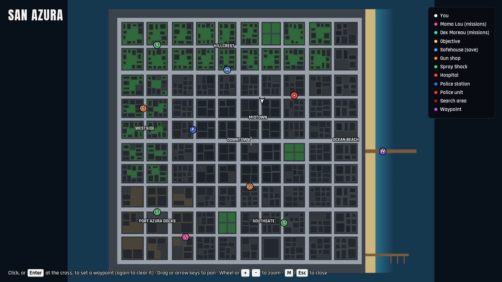

# The map of San Azura

San Azura used to be one perfect square: a 10 by 10 grid of blocks inside a ring road, a promenade round three sides and the beach on the fourth.
This page explains how the city is built, what depends on its shape, and how the shape was broken up without rewriting the road network, and how Las Lomas County's roads join it from outside the grid.

## How the city is built

`src/world/layout.ts` generates the whole city from `CITY_SEED`, so every game (and the multiplayer server, which runs the sim from source) gets the same San Azura.

- Eleven vertical and eleven horizontal road lines (`vLines`, `hLines`) cut the land into 10 by 10 cells.
  Column widths and row depths vary a little (72-92 m), and lines 0, 2, 5, 8 and 10 are four-lane avenues.
- Each cell is a block: a sidewalk ring round a lot, cut into parcels that become buildings, yards, parking lots or container yards by district.
  Parks, the stadium and the special places (safehouse, hospital, police, spray shacks, gun shops, the bank, the contacts' places) are fixed cells.
- Outside the ring road lie the promenade (west, north and south), the boardwalk and the beach (east), the pier and the Marina.
- `src/world/roads.ts` turns the lines into a directed lane graph: a node at every line crossing, lanes between neighbouring nodes, turn curves, signals and A* routing.
- `src/world/sidewalks.ts` builds the pedestrians' graph: a loop round every block, crosswalks at every junction and the promenade loop.
- `src/world/staticWorld.ts` answers the sim's questions: colliders, ground height, water depth, zone and district names.

## What depends on the shape

Most gameplay places are found from the layout rather than written down as coordinates, so they move with it:

- Points of interest (`layout.pois`) carry their own positions; missions, activities, the multiplayer markers and respawns read them.
- Mission spots (`src/sim/missions/spots.ts`) pick block centres and road nodes by grid index (`blockCenter(bi, bj)`, `roads.node(i, j)`).
- Street-run courses (`src/sim/streetRuns.ts`) are lists of grid corners, routed along the road lines.
- Gang turfs (`GANG_TURFS`) are ranges of block indices.
- The courier place sits by the middle dock crane; Azura Customs and the pier arcade are offsets from the hospital and the pier.
- Zone and district lookups (`zoneName`, `districtAt`) and the map screen's zone labels index blocks by cell.
- Tests and playtests address junctions as `roads.node(i, j)`.

What assumes the square:

- Every road segment and node exists, and every node's degree follows from its grid position (signals, furniture, crosswalks).
- `isOnRoad` treats every line as road from one side of the city to the other.
- Land is one rectangle; the only water inside it is under the pier and the Marina.
  The ground renderer draws the promenade as three strips and the ring road's outer kerb as four long walls; the sea shader knows the land as one rectangle.

## The changes

The road network stays a grid of axis-aligned lines, because the lane graph, the sidewalk graph, the collider grid, the renderers and the AI all work on rectangles and four directions.
Inside that, the city loses its uniformity in four ways.

### Connectivity: segments and nodes can be missing

The layout records which road segments exist.
A segment exists when it borders at least one land block and does not run through the middle of a superblock or along the canal.
A node lives when one of its segments exists, and its degree, signal, crosswalks and furniture follow from its real neighbours.
The node grid keeps its 11 by 11 indexing, so `roads.node(i, j)` still names the same junction everywhere; dead nodes are skipped by routing, nearest-node searches and drawing.

### Superblocks

`layout.cells` maps each grid cell to its block, so one block can cover several cells:

- Hillcrest Green becomes a two-by-two park, the streets inside it turned into lawns and paths.
- The Azura Bowl takes two cells: the bowl in the middle, a car park at either end.
- Downtown gets Civic Plaza, two cells with towers at either end of an open square: paving, two lawns, a fountain and rows of trees.

The cells were picked where nothing else depends on the closed streets: no street-run course, mission spot or test junction runs through them.

### Water: a cove, a harbour basin, a canal and a headland

- **Hillcrest Cove** takes the north-west corner: two cells become sea, and the coast road turns round the water behind a sidewalk-wide quay.
  The Hillcrest Spray Shack moved one block east, out of the drowned cell.
- **Port Basin** cuts into the docks from the south: two cells become a harbour basin, with a 20 m wharf along the docks' last street where the three cranes now stand, and four boats moored in it.
- **Cortez Canal** replaces Cortez St, running from the north coast to the south coast between Westside and Downtown.
  Every street crosses it on a bridge: the junction's box is the carriageway (a deck at road height, no signal), with a footway deck either side and a parapet along each footway's outer edge; each promenade has a footbridge along its seaward edge.
  Columns 2 and 3 give 11 m each to it, so every other road line stays where it was.
  The Dockside Switchback street run moved its switchback one street east and crosses the canal twice.
- **Azura Point** is a headland of lawns, trees and benches reaching out into the bay from the north promenade beyond Hillcrest Green, with a path out to the lighthouse at its tip (the lighthouse used to stand at the promenade's north-east corner).

Water is a list of rectangles (`layout.water`) cut out of the land, and headlands (`layout.headlands`) add land outside it: `baseGround` is the seabed in the water and the curb height on a headland, zone names follow both, the quay walls are built wherever land meets water (`render/city/coast.ts`), the ground renderer leaves the water out of the promenade and draws the quays, and the sea shader keeps its quay foam off the old land edge where the sea now comes in.
Pedestrians keep to dry land: the promenade loop breaks where the sea comes in, and the bridges' footways join the sidewalks either side.

### Bays: the coast steps in and out

- **Gull Bay** (one cell) and **Northshore Bay** (two cells) drown the north shore either side of Hillcrest Green, so the shore runs bay, park and Azura Point, bay.
- **Pelican Harbor** (two cells) bites into Westside's shore between the cove and Port Basin.
- **Coral Bay** (one cell) cuts into the south shore west of the beach.

These bodies are drowned rather than left out: their blocks are generated as land, and once the street furniture stands, `drown()` removes the blocks and everything on them, closes the roads that bordered only them, keeps a signal only where three roads still meet on a live approach, and lets the water in.
The shared generator therefore makes exactly the draws it made while they were land, so every other lamp, tree, hydrant and bench, building and parked car stays where it was; only what stood in the bays moved.
Building ids keep their gaps, so facades and rooftops elsewhere keep their looks.
The ring road is not closed with them: it crosses each bay's mouth on a bridge (a carriageway deck at road height, a footway deck either side and a parapet along each, like the canal's), so the coast road runs on.
Closed, it turned the junctions either side into corners with a single way out, where a car fleeing the police was pinned against the quay (`r2_police_escape*`).
The bridges, the canal's and the bays', are drawn as one mesh: a few slabs across the city would only add draws if split into cells.
The two stunt ramps that stood in Pelican Harbor and Gull Bay moved along their promenades, and Hot Delivery's drop is now found from the block south of Northshore Bay.
The ramps' plates and side panels are drawn as one mesh each, like the bridges: five ramps across the city would only add draws if split into cells.

Where water still cuts an avenue short, it leaves a stub whose far end leads only into side streets.
A city bus keeps to the avenues that go on (`throughAvenues` in `src/sim/driver.ts`): traffic spawns none on a stub, and a bus on the move never turns into one.

### Hills off the road grid

Hills were first set aside: vehicle physics, the collider grid's fixed height bands, the ground and facade renderers and the traffic and police AI all assume flat ground, with the ramps and decks the only slopes and steps.
They came back where none of those assumptions reach: off the road grid, on ground that no road, sidewalk, walk node or building footprint stands on.
`src/world/terrain.ts` holds the rises and everything they need.

- **Hillcrest Green** rises 7 m on its fountain at the top of Coral St: an elliptical cosine bell 136 by 156 m across, flat on its summit and 0 a good 7 m inside the park's lot, so the streets and sidewalks round it stay flat.
  Its steepest grade is 20%, gentler than the stunt ramps.
  The SAN AZURA letters stand on its south slope, facing down Coral St, the words either side of the old path up to the fountain and the last A slumped on its side.
- **Azura Point** climbs from the promenade to a 10 m bluff: the ground rises with z alone, in a smoothstep over 72 m (20.8% at its steepest, no cross-slope), then runs flat out to the tip, so the lighthouse's lamp shines from 36 m over the water.
  Its sides drop sheer into the sea (`render/city/coast.ts` draws them as rock, with the boulders heaped higher where the cliff is taller), 11 m round the tip and nearly 9 m where the base meets it on either side.
  A parapet rails a 24 m lookout along the cliff edge in front of the lighthouse; the rest of the edge is open, so a car driven off it flies and sinks, and someone who steps or jumps off splashes in before landing, so takes no harm, and cannot climb back up the cliff: only near the promenade is the ground low enough over the water.
  A fall of more than 8 m into the water pays a CLIFF DIVE bonus, once a game day.

Each flat-ground assumption is kept like this:

- **The layout.** `settleTerrain` runs last in `generateCity`: it records the rises and stands every prop on them, drawing no random number and moving nothing across the ground, so the pickups and the mission spots stay where they were.
  It drops no prop either, so every prop index an earlier pass recorded still names its prop, and the letters stand on a strip of the slope where no trunk is in their way.
  The 29 trees on the lawn in front of the letters stand there as bushes, scrub under the sign as on the hillside it parodies, so it reads from Coral St and Magnolia Ave.
- **The ground.** `baseGround` adds the rises on the lawns and the headland, and the roads, sidewalks and buildings all stand where they are 0, so every lookup there returns what it always did.
  The ground renderer draws a patch over a rise as a grid on a 2 m lattice, its triangles within a centimetre of the sim's slope.
- **Physics.** The slopes are smooth and never steeper than 21%, so a car follows them (ground follow tracks a drop of up to 0.4 m per 1/120 s step), never hits a ledge, and crosses the summit at 30 m/s without leaving the ground; the body's roll across the slope is drawn only.
  People walk up them as they step up a curb.
- **Sight and shots.** Colliders stand in fixed height bands, which no box can fit to a slope, so lines of sight and shots test the rises' ground itself (`riseRay`, sampled every 2 m along the ground, within 6 mm of the slope).
  A police officer's or a witness's line of sight, a bullet, a blast or a fire's spread stops where it runs under the turf, and an officer chasing you on foot across the park loses you over the crest.
  The hill is too broad to hide you from the streets round it: within the 80 m an officer sees, what lies behind the crest is out of a street's range.
  A shot's test against the level ground (roads, lawns, decks) is taken under the rises, so a shot fired down a slope flies on to what it is aimed at.
- **The collider grid's height bands.** The camera's rays and the police drivers' look-ahead know only the collider grid: for them, sight-blocking boxes, nested every 2 m of rise, are buried in the hill and the bluff.
  Each stands half a metre under the turf over its footprint grown by 6.5 m, farther than any body, free-space check or camera that tests its own height band reaches from where it stands, so nothing on the ground ever meets one.
- **The AI.** No lane and no walk node is on the hill: traffic and the police keep to the streets round it, and officers walk up it on foot.
  The only walk on a rise is the path out to the lighthouse, which pedestrians and officers climb as they climb a curb.

### Attractions: single cells rebuilt as places

Two cells are rebuilt once the city stands, by `buildAttractions` in `src/world/attractions.ts`, a pass modelled on `drown()`:

- **Hollister Farm** on cell (3,0), between the canal and Gull Bay: a gravel lane from a gate on Hillcrest Rd, the farmhouse, a red barn, a silo, forty pumpkins and a corn maze either side of the lane's mown aisle, with a hay-bale kicker on the lane that throws a car down the aisle.
- **Eternal Palms Cemetery** on cell (1,1), across Hillcrest Rd from the cove: paths in a grid, about 140 headstones in rows, twelve of them epitaph stones, a chapel with a bell tower, three family mausoleums, cypresses and an iron fence.

The pass runs in `generateCity` just before the ground floors, after the street furniture, the drowned bays, the coast, the stunt ramps and the water filters; only the ground floors, Turbine Row and Smuggler's Key, AzuraLink and the hills' settling come after it.
So every shared random draw is made as before, and the pass draws only from its own generator per attraction (`hashInts(seed, 9001, k)`).
It clears each cell's lot (buildings, ground, garages, props and parking), every lot before it builds any, so the props it appends keep their indices.
Unlike `drown()`, it keeps the sidewalk ring and its furniture, except in a gate's span.
New building ids are one more than the largest, since `drown()` left gaps.
The block keeps its district and takes the attraction's name as its zone, so the HUD, the map and the police scanner name it.

**The open-spot rule.**
The hidden packages and pickups are placed over the city's open spots (`src/sim/pickups.ts`, farthest first), so dropping or moving one spot would move all twenty packages.
An attraction therefore keeps every open spot in its cell, and keeps each one free: no collider within a metre, none on a ramp.
Two of the farm's spots lie under its kicker's flight, one a metre past the lip and one where a car at full throttle lands.
The lane's spots are 18 to 24 m apart and a car lands 12 to 25 m past the lip, so the kicker could stand nowhere on the lane without one there.
Neither spot receives a package or a pickup, which `tests/unit/attractions.test.ts` holds.
The farm's lane runs down the line of the old yards' setback spots, and the cemetery's paths across it run where its fifteen spots lie.
`tests/unit/map_guard.test.ts` pins the mission spots of both chapters, the filtered open spots and the landmark towers, recorded before the pass existed.

What the attractions add to the world:

- Corn is a breakable collider of its own tag (`crop`): it stops people, barely slows a car (each segment takes 3 % of its speed) and hides nothing from a line of sight.
  The maze and the barn are *cover* (`StaticWorld.coverAt`): there officers see a target only within 10 m and the helicopter crew only within 15 m along the ground, where the barn's roof is in the way.
- The barn is a garage without a marker (its walls, roof slab and dark interior are a garage's, but none of a garage's benches, tyres and posters); the chapel, the tower and the mausoleums are solids of the attraction, not buildings, so facades, rooftops and the landmark towers never see them.
- The hay-bale kicker is the sixth stunt ramp, and its run-up and landing keep the corridor every ramp keeps.
- Pumpkins and ordinary headstones break; the twelve epitaph stones do not.

### Offshore: Turbine Row and Smuggler's Key

The world's edge now reaches 544 m out from the north promenade instead of 160 m, to z -1060.
Those 384 m are exactly 32 cells of the collider grid, so every older collider keeps its cells and its contact order.
Whatever moves is held inside the new edge, and the map and the rain's cover grid grow with it.

- **Turbine Row**: ten wind turbines in two staggered rows of five, 112 m apart along each row, 274 m and 389 m off the north shore (`src/world/offshore.ts`).
  Each is a `turbine` prop whose tower is a pillar from below the swimmers' band up to its nacelle, so boats, shots, the camera and line of sight stop at it.
  The blades are drawn only, 30 m and more above the water.
- **Smuggler's Key**: a second headland, about 95 m off Northshore Bay's mouth and as far east of Azura Point's tip.
  It has turf and dirt, three palms, a jetty (a deck with a lamp at its end) and the low walls of Fort Contraband's battery, which are solid (`layout.offshore.solids`).
  Its two cannons, the fishing boat wrecked on its rocks and its two signs are drawn only.
  As a headland it is land at the kerb's height, with quay walls and heavy foreshore rocks round it and a zone name of its own.
  The sidewalk graph only knows Azura Point, so nobody walks, parks or spawns on the Key.
  A rifle and body armor wait in the ruins, at spots of their own placed after every other pickup.
- **The Gull Regatta** runs from the Marina up the coast, through the near row of turbines, once round the Key and round the lighthouse, and home (`src/sim/activities/regatta.ts`).
  Every gate keeps 30 m from a tower and from the Key's rocks.

`buildOffshore` appends all of it once the ground floors are assigned, drawing from its own generator.
Every older prop index, collider and pickup, the mission spots and the open spots therefore stay as they were.

## Las Lomas: roads outside the grid

Las Lomas County is about 0.9 km² of farmland on six rectangles west of the city, across Lomas Sound (x -700 to -512), with Coyote Ridge along its west coast and a beach round it (`src/world/country/index.ts`).
Two links reach it: the Magnolia Causeway, which runs Magnolia Ave on from Harbor Blvd as a 16 m highway on a headland of its own with grass verges, lamps every 30 m and quay walls and rocks along its sides, and the Southgate Bridge, which carries Southgate Ave over the sound on a deck under a steel through-arch.
Its 3.3 km of roads join the city's lane graph, so traffic, the police, the cab, the GPS and the radar all know them:

- **The Magnolia Causeway** to Dry Creek's crossroads (-840, -268), the county's town.
- **The Lomas Highway**, a 2+2 loop: on west past the Hollister T (-1104, -268), south round a 180 m curve, down the west of the county, east round a 150 m curve, and back along Southgate Ave's line past the Creek T (-840, 268) and over the bridge to Harbor Blvd.
- **Hollister Lane**, a lane each way round the farm north of the highway, from Dry Creek back to the Hollister T.
- **Creek Road**, a lane each way from Dry Creek south to the Creek T, swerving 11 m east and back on the way.

**The outer graph.**
The roads are chains of straight lanes through bend nodes, not a new road model: every lane is still one straight line, so everything that reads a lane's start, end, direction and heading works unchanged.
The county's 52 nodes, 160 lanes and their turns come after the grid's 121 nodes and 574 lanes in `roads.ts`, so every grid id, lane and turn keeps its number and order.
A node stands at every vertex of every road: a bend where two links meet (`isBend`), a signalled junction where three or four do (`junction('drycreek' | 'hollister' | 'creek')`).
Each link takes the slot of its bearing at its first node and the opposite slot at its second, so a lane's reverse is `laneFrom(lane.to, reverseDir(lane.dir), 0)` as on the grid, and junction arms keep within 15 degrees of an axis, so the grid's slot arithmetic gives the turns there; at a bend the one turn is the 'straight' continuation.
The rules a road keeps: no dead end, bend vertices 20 to 30 m apart turning at most 10 degrees on curves of 120 m and more, none within 30 m of a junction, every bend lane 19 m or longer (so a driver still plans 70 m ahead within its 8 steps), and everything flat.
Speed limits are 22 m/s on the highway and 15 on the country roads, each capped on a curve at what a car holds round it.
The gateways, Magnolia Ave and Southgate Ave at Harbor Blvd, gain the link in their empty west slot and keep their signal phases: the causeway joins Magnolia Ave's east-west green.

**The city does not move.**
City code paths keep their exact code; county behaviour branches only on an outer node or lane, or on a point off the city or land rectangle.
`nearestLane`, `nearestNode` and `isOnRoad` answer in the city as they always did, and off it add the county's lanes, nodes and road (and the links' mouths through the promenade), a tie staying on the grid.
The police's unfiltered draw over every lane keeps the grid's lanes wherever the world reached before the county (x -672 on), traffic's, the police's look-ahead and a mission's chasers' pools add the county's lanes only off the city's land, and bends count as no junction where the traffic, the police and the roadblocks count junctions ahead.
`tests/unit/city_guard.test.ts`, recorded on the untouched round-2 head before any of this existed, hashes the grid's nodes, lanes, turns, signals, routes, distance fields, walk graph, props, colliders and street-run courses, and the ground and lookups on a lattice over the old world; the single-player trace, the crowd fixture and the multiplayer core's trace replay byte for byte.
`buildCountry` runs last in `generateCity` and only appends, but for four props it moves out of the links' mouths (two lamps, a tree and a bench, each keeping its index); its colliders come after every older one.
The promenade's edges across the mouths become crosswalks on the gateways' lights and keep their places among the walking edges, so pedestrian spawns draw as before.
The county's verges join no city walk node and are no spawn ground: pedestrians spawn in the county only from its own footpaths (`layout.country.walks`: Dry Creek's boardwalks).

**The farms.**
Four of the plots are farms (`src/world/country/farms.ts`), appended by `buildFarms`, the one call between the landscape's and the places' at the end of `buildCountry`, from its own generator:

- **Hollister Bottoms**, inside Hollister Lane's loop: corn either side of a mown aisle and north of the farmyard, which opens east onto the lane, with a red gambrel barn, three grain bins, a windpump over its stock tank and the farmhouse.
- **The Cud & Sons Dairy**, by Creek Road: the whitewashed milking barn with twin silos and the propane tank behind it, fifteen cows in a fenced pasture, lettuce and furrows.
- **Pippin Hollow**, by the highway's west leg: about five hundred apple trees in rows, ladders against a few, and a packing barn.
- **Halfmoon Acres**, by the highway's south leg: wheat behind a post-and-rail fence with an 8 m gate on the highway side, sunflowers either side of an aisle, furrows, and bale stacks in the yard.

Each farmyard has a barn, which is a garage (its walls and roof slab, which hides the bay from the helicopter, with a gambrel roof drawn over it), a farmhouse, which is a building like a city house, a sign and a mailbox by its dirt drive, and two bays appended to the parking.
Hedgerows run along the plots' edges beside Hollister Lane and Creek Road and round the orchard, with gaps at the gates; the corn, the wheat and the sunflowers stand open to the highway.
A hedgerow is a collider of its own tag (`hedge`): solid for sight and shots, so traffic can stream in behind one, but not for the camera, which looks through it rather than snapping in.
Where one stands between the camera and the player (or his car), it opens round the line between them, and it dissolves right at the lens as foliage does (`src/render/country/farms.ts`).
Nothing stands within 12 m of a road edge, every collider is in a farm plot, and no open spot is added.
The farms' buildings, garages and hedgerows take their colliders after every older collider (`firstBuilding`, `firstGarage`), so the city's keep their ids.

The fields are data: a rectangle, a crop (corn, wheat, sunflower, furrow or lettuce) and the direction its rows run.
The corn and the sunflowers are cover (`StaticWorld.coverAt`, as Hollister Farm's maze is), and a car whose centre is in them drags through them at a quarter of wading's drag (`cropAt`); they have no colliders, so people walk through them.
They are drawn at a cost set by what the camera sees (`src/render/country/fields.ts`):

- Every field's ground is a slab over the grass with its crop's rows, turned along them; the wheat's ripples in the wind.
- Within a ring round the camera (44 m on High, smaller on Medium and Low, none on the software tier), the plants themselves come from fixed pools: Hollister Farm's ten-stalk corn cards on its sway, wheat tufts, and sunflowers whose heads turn with the sun.
  The pools are refilled when the camera moves into another 16 m cell, each plant at its own place on its field's lattice, so none of them moves between refills.
- Past the ring, the corn and the sunflowers are a block each: a top textured as the crop from above and sides of stalks with a ragged top, drawn from outside only (from inside too on the software tier, which has no plants); plants and blocks dither into each other over the ring's edge.
  Far from the fields, the empty pools are neither refilled nor drawn.

The cows and the twenty scarecrows are breakable props kept by index.
A cow hit by a car slows it hard, with a moo instead of a crash; E beside one from 21:00 to 05:00 tips her over, in single player only (a multiplayer room has no cow to tip, as its scarecrows count for nobody).
At 06:00 every cow stands up again, by a rule of the clock alone that a multiplayer client's mirror applies as the server does, since no message stands a prop up again.
The dairy's farmer stands outside the pasture's gate while a player is within 120 m of it, as Old Man Hollister keeps his porch, and shouts when a cow within 90 m of him goes over.
The scarecrows pay $3,000 once all twenty are down (`src/sim/farms.ts`, saved), as Hollister Farm's pumpkins do.

**The plots contract.**
The county's land is split into named plots (`COUNTY_PLOTS`) that the content passes fill: Dry Creek (a town round the crossroads), Hollister Bottoms (inside the farm loop), the Cud & Sons Dairy, Pippin Hollow, Halfmoon Acres, the Moonbeam Drive-In, Gravel Gulch and Coyote Ridge; the rest is wild.
Every plot but the town keeps 12 m off the road edges, and every road keeps 30 m inside the land.
The content passes go at the end of `buildCountry`, each one call that only appends, in this order: the landscape, the farms, the places.
They add no open spot (the hidden packages are placed over the open spots), append parking bays only at the end, stand their props on `countryGround`, and keep their rises in `layout.country.rises`, which only the county's ground reads.
The HUD and the scanner name the plot you are in, or Las Lomas County.

**The landscape.**
`buildHills` (`src/world/country/hills.ts`) is the first content pass, and keeps every rule above.
- **Coyote Ridge** runs along the west coast, round 2's `terrain.ts` with a third kind of rise, the `'ridge'`: a crest along x -1475, 24 m high and 20 m wide across its flat top from z -470 to -80, falling away in a cosine on each side and at each end.
  Its east flank falls over 115 m to its foot 12 m off the Lomas Highway's west leg (32.8% at its steepest), its west flank over 108 m to the beach (34.9%), running 33 m out over the sand, and its north end over 110 m to the north shore (34.3%), which a Nightjar takes at 60 m/s.
  Its south end is a 270 m shoulder (14% at its steepest), the one the fire road climbs.
- **Five foothills**, cosine bells of 4 to 10 m, stand on the wild ground: Coyote Knoll north of the highway's bend, Gulch Hill west of Gravel Gulch, Cove Rise by the south cove, Sound Bluff on the sound's shore south of Dry Creek, and Bend Knoll inside the bend.
  No two rises overlap.
- **The contract**, tested on a 1 m lattice: every rise is 0 within 12 m of every road's edge, on every plot but the wild ones and at every verge node, so the roads, the verges, the farms and the places stay flat.
- **Six wind turbines** stand along the ridge's top, on the west half of its line, 110 m apart and at least 40 m from Lookout Point, Turbine Row's kind and renderer on a foundation of their own: their towers stop cars, shots and sight from 1 m under the ground up past the nacelle.
  Four stand on the crest, the first just off its north end, and the last two past Lookout Point down the south shoulder, 22 m and 9 m up: a row of six 110 m apart runs 550 m, and the 390 m crest keeps 40 m clear of the lookout.
  Two belts of trees line the ridge's east foot, and bushes (no collider) grow over the slopes.
- **Sight and shots.** The county's rises live in `country.rises`, which only `countryGround` reads, so the city's `baseGround` still loops over its own two.
  Lines of sight, shots and the camera's terrain test follow them as they do the city's (`riseRay` over the ground they stand on: the county's own, with no curb, and past the land's edge the beach the ridge's west flank runs out over), and their sight cores, twelve for the ridge, are appended after every older collider.
  The cores are kept inside the land, since the ridge's west flank runs on over the beach, where the ground is lower than the rise alone.
  Two people on the crest see each other; across the ridge at a man's height nothing is seen.
  A swimmer off the west beach is seen from the sand, from a boat and from the air, and a shot reaches him.
- **The fire road** is a 6 m gravel track, drawn only, from a turn-off on the west leg up the ridge's south shoulder in five axis-aligned switchbacks and along the crest's flat top to the car park at Lookout Point, 297 m and 17.1% at its steepest, on ground no steeper than 21%.
  It is not in the lane graph: traffic never takes it, and past 45 m off the road the police come up it on foot.
- **Lookout Point** is a flat car park on the crest, 24 m up, facing the city 1.4 km off across the county and the sound, with a parapet along its east edge, a plaque (LOOKOUT POINT. ELEV. 24 M. THE CITY LOOKS BETTER FROM HERE. SO DOES EVERYTHING.), a coin telescope (VIEWS 25 CENTS. CITY SOLD SEPARATELY.) and a timber fire lookout on four posts.
- **The Coyote Ridge Hill Climb** (`src/sim/activities/hillClimb.ts`) starts from a foot gate on the turn-off: in any road vehicle there, T starts a timed run through six gates in order up the fire road to Lookout Point.
  Its medal times come from a scripted Nightjar run of 14.95 s: gold 15.7 s, silver 18.7 s and bronze 23.9 s, paying $1,000, 70% and 45%.
  The best run is saved with the activity records, and it is single player only.
- **The beaches.** The county's coast is beach all round: the sand runs 8 m out from the land's edge to the waterline and falls to the flat seabed 45 m out.
  The sea draws it from a depth map baked from the county's ground, so turquoise shallows ring its coves and points for about 15 m past the waterline, with surf bands and swash on the sand, and Lomas Sound stays blue between it and the city.
  The surf is heard anywhere on the county's land within about 180 m of its waterline; the causeway's quay walls make none.
- **Reflector posts**, drawn only, stand every 25 m along both edges of every county road on the land, clear of the junctions, of the fire road's turn-off, of the drives into the farms, the drive-in and Gravel Gulch, and of Dry Creek.

**Junctions without lights.**
Every road has a priority (the highway 2, the country roads 1), and the Hollister T and the Creek T (`STOP_SIGNS`) have stop signs instead of lights: `RoadNode.stops` marks the arms that stop, Hollister Lane's and Creek Road's.
The signal head for a stopping arm is a stop sign (a `stopSign` prop, breakable like a lamp) behind a stop line, and the heads for the highway's arms are lamps over the junction, so every later prop keeps its index; Dry Creek keeps its light, and no grid node has a stop.
A driver obeying the lights stops its front bumper at the line, stands there 0.6 s, and goes once the junction holds no vehicle that someone drives or that moves above 1.5 m/s, and nothing above 1.5 m/s is coming in on the highway within 30 m or the gap it needs (`DriverAI.goFromStop`).
A wreck or a car left standing in the junction is in the way like any obstacle, not traffic to wait for: counted as traffic it held the country road at the line for good.
Turning right it needs 3.5 s of the traffic it pulls out in front of; turning left it crosses the near lanes from a stand and needs 4.5 s of both; a vehicle slower off the mark than a car (a tractor, a bus) needs longer, and one kept waiting takes gaps down to 0.7 of those after 10-20 s.
Pursuers run stop signs, and a stop sign cannot be held green: the street runs' green wave and `holdSignal` pass over a junction without lights.
On the county's lanes a left turner yields to any oncoming car up to 4.5 s away, not only within 38 m as in the city, since the highway's 22 m/s covers 38 m faster than a turn takes.
The spawner treats a stop line like a red light (a car queued there spawns standing), starts no car at speed within 50 m of a county junction on its lane, and queues no highway car at a stop sign for a fast player: in the ten-minute soaks those were the cars that hit turners.
`tests/unit/traffic_deadlock.test.ts` stands ten minutes at each T for each of seeds 1-12 in the game's traffic, and once more at the Creek T with a car parked in its box: nothing collides in either junction, and no wait at a line passes 40 s.
The longest is 39 s, and 5 of 1078 stops (in 5 of the 24 runs) wait over 30 s.
The bound is 40 s, not 30, for three reasons: a left turn from the country road needs a gap in both of the highway's streams at once; no cheap rule tried (shorter gaps, sooner impatience, a forced go) got the longest under 36 s without collisions in the box; and the traffic's density never goes above 1.0 in play (at 1.5 times the traffic the Creek T's left turns waited up to 85 s).
If a later round finds them wanting, emptying `STOP_SIGNS` gives both junctions their lights back.

**The county's traffic.**
In the county (`COUNTY_BOUNDS`) the traffic is 0.4 of the city's, and `countryKind` turns half the sedans into pickups, the taxis into Haymaker tractors, the buses into pickups and the sports cars into muscle cars, by a hash of the place after the draw, as `trafficBike` does, so the sim's random stream and every city kind stay as they were; parked bays take the same remap by place.
A tractor cruises at 0.9 of its 12 m/s, and the traffic behind it queues and honks, since a driver overtakes only what holds it under 3 m/s.
The open fields hide little, so for a fast player on a county road the spawner adds spans on the oncoming lanes along his road: 120-220 m ahead, which spawn only where something hides them, and 330-420 m ahead, beyond the 320 m the never-pop-in rule looks.
At most two cars come his way from them at a time, and a car coming his way on a county lane is kept within 520 m whether he sees it or not.
Seen from the city's land within 200 m of a link's landfall (`LINK_REACH`), two cars at a time come in over the causeway and the bridge, spawned on the links' lanes into the city out of view as far as 520 m, since nothing on the open water hides one.
No street run's course in the city comes within that reach (Dockside's comes within 210 m of the bridge's), so no lap there depends on them; the Las Lomas Loop starts 186 m from the causeway's landfall and runs over both links, so its countdown and its laps meet the cars coming in.
Where each spawns, its kind and colour, and its driver's looks and cruising speed come from a generator of their own (`linkRng`), so the spawns draw nothing from the sim's.
Once on its way such a car's driving (its turns, its honks) draws from the sim's generator like any car's, so near the links they change the city's traffic; the recorded fixtures never come within 354 m of either landfall.
They come in single player only: `streamTrafficMulti` has no such stream.
A patrol cruiser placed in the county is the Las Lomas County Sheriff's (`SHERIFF_COLOR`, a tan body with a gold star on the doors), and while the suspect or the place named is in the county the sheriff's own dispatcher, in a voice of his own, calls the chase; only he names the county's places.

### The places

`buildPlaces` (`src/world/country/places.ts`) is the last of the content passes and fills three plots: Dry Creek, the Moonbeam Drive-In and Gravel Gulch.
It draws nothing from the city's generator (the stores' tints come from its own), and it only appends.

**Dry Creek** stands round its crossroads, the county's only traffic light, with the main street on the Lomas Highway.
- Its stores are buildings of district `'country'` (DRY CREEK FEED & SEED, BANG BANG GUNS & BAIT, MOO-MOO'S DINER, GAS & GRITS, the SHERIFF'S OFFICE and three more), not blocks: the walk graph builds its block loops first, so appended blocks would shift its walking edges.
  A store is a false front (tier 0, the tall board on its street side) and a body under a gable (tier 1).
- Their colliders come after every older one (`country.firstBuilding`, as `firstProp` for the props), so every older collider keeps its id.
  The city's building renderer skips them; `render/country/town.ts` draws them with the city's own facade materials, so their windows light at night as the city's do.
- The grain elevator (40 m), the water tower (DRY CREEK. YOU'RE ALMOST SOMEWHERE.), the World's Second-Largest Corn Cob and Gas & Grits' canopy are the places' solids, added after the county's props.
- People spawn on the boardwalks in front of the stores (footpaths with `spawn`), which join the verges at the crossroads' corners.
  A county footpath that crosses a road is a crosswalk on the light of the junction nearest it, which gives the town the crossings over its south and east arms that the verges lack.
- A bust off the city's land walks out of the nearest police station (`bustStation`): the Sheriff's Office in the county, SAPD Central anywhere on the city's land, as before.
- Gas & Grits' four pumps are breakable props: one knocked down, by a car or a blast, goes up a moment later and knocks down the pumps within 13 m, so the forecourt goes up one pump after another (`sim/dryCreek.ts`).
  Each goes once, which caps the chain; the blast is the doing of the nearest player within 40 m.

**The Moonbeam Drive-In** stands on the county's east shore, its 30 by 14 m screen facing inland with the city across the sound behind it.
- The bill runs on the game's hours alone (`sim/driveIn.ts`): a pre-show card from 19:00, THE CORN THAT ATE SAN AZURA at 19:30, the dancing hot dog's intermission at 21:00, ATTACK OF THE 50-FOOT SCARECROW at 21:15 and the first film again at 23:00, dark from 00:30.
  A multiplayer client works out the same reel from its mirrored clock, with nothing in the snapshot.
- The screen's canvas is redrawn only when the scene changes, the films' lines burned in under the picture.
- Its forty bays stand in arcs nose to the screen, after every older bay; they fill, nearly all of them, only while the lot is open (19:00 to 01:00), under the parked cars' usual out-of-view rule.
- A player's horn in the lot while a film runs sets the cars round him flashing their lights and a moviegoer shushing him (`driveInShush`, at most once every 4 s).
- The screen's frame is solid, so you can hide behind it; the booth, the concession stand and the marquee's posts are solids too, and the speaker posts break.

**Gravel Gulch** is a dirt loop of about 1.1 km south of the highway, with a hairpin loop up its middle, six whoops and two tabletops.
- The whoops and the tabletops are ramp pairs (a ramp up to a crest, one up to it from beyond) that are not stunt ramps (`Ramp.stunt` false): a jump off one is no stunt, and the stunt jumps' total is still the six.
  A tabletop's top is a deck (`Deck.dirt`, drawn by the track, no pier under it), and its face rises 0.7 m over it, so a rider at speed leaves the ground at the lip.
- The ribbon, the berms round the turns and the flags are drawn only.
- The scramble (`sim/activities/scramble.ts`) is two laps against the clock, nine gates a lap, in anything with wheels; its medals come from a scripted ride on a Viper 600.
  A gate stands at each turn's apex, its centre pushed out from the line so its 8 m reach comes in to the track's inside edge and runs out over the berm, and the ninth on the start line.
  Straight lines from gate to gate save about 20 m a lap on the track's own racing line, cutting a turn's inside by 7 m at most; gates spread evenly round the lap had let a rider save about 95 m across the infield.

**The Las Lomas Loop** is the fourth street run, about 3 km: west down Magnolia Ave, over the Magnolia Causeway, through Dry Creek and round the Lomas Highway, home over the Southgate Bridge and north up Vista Ave.
- A course's corners may name a county junction or a gated bend; the legs to and from one take the shortest way on, never back the way it came.
- Its gates stand at junctions and at the apex of each of the Lomas Highway's two curves out west, at no other bend, and its distance runs along the road.
  Without the curves' gates the 1.1 km round the west loop from the Hollister T to the Creek T had none, and a U-turn back through Dry Creek and down Creek Road (0.8 km) or a line across the fields (0.6 km) cut it; through both, a line across the fields saves about 45 m on the road's own racing line.
- The green wave walks the course's gates, so it holds the gateways and Dry Creek for the racer; on the city's courses those are the same junctions as before.
- `buildStreetRunCourses` keeps the city's three byte for byte, and the loop comes after them, so multiplayer offers it head-to-head as it does the others.

### Roadside oddities

`buildOddities` (`src/world/country/oddities.ts`) is the last content pass, after the places: small useless things beside the county's roads, none of them in a plot.
It draws from no generator and only appends: its solids go in `country.oddities.solids`, which `StaticWorld` adds after the places', so every older collider keeps its id, and its nine mailboxes and signs are the last props (`oddities.firstProp`; the places' own props end where they begin).

- **Telephone poles** stand 40 m apart along the right-hand side of every county road, 4 m outside its edge, 8.6 m tall with a crossarm of four insulators.
  A pole is left out within 16 m of a junction's box, 10 m of a farm's drive, sign or mailbox, 14 m of the drive-in's and Gravel Gulch's drives and of the fire road's turn-off (each pass lists its own in `country.approaches`, as a rect and how far to keep from it, so a farm or a place added later adds its drive there and no pole stands in its mouth), in Dry Creek, in a stunt ramp's 300 m run-out lane (`fix_progress_world` keeps every solid off those), and 3 m from any other oddity; a wire spans a gap of two poles (82 m) at most, and none is strung across a longer one.
  Four wires hang between each pair as catenaries (`sagAt`): 0.6 m at mid-span for 40 m, 2.8 m for 82, so the lowest is 5 m over the road.
- A pole's collider is a rock's: solid, and see-through to sight, shots and the camera, as a street lamp's is (it is not a lamp's, which the camera's occluders know for a prop).
  As a pillar it hid cars from the traffic's streaming (which places them out of the player's sight) and slowed the Creek T's soak test by about 9 s on average, and the camera snapped in at every pole.
- **The cow** (BERTHA, on a flatbed, the farm cow of `farmModels.ts` 3.2 times as big), **the stand**, **the diner's sign** (a saucer crashed beside its board, its beacon blinking red and green after dark), **Bigfoot and his plaque** (on a gravel pull-off against the highway's west leg), **the pickup** (flat tyres, hood up, weeds), **the bus** (a henhouse), **the hives** and **the payphone** are drawn in two meshes (the cow wears her hide's texture) and their boards in the places' atlas.
  Each has solids sized to its model, boxes along the axes (so the pickup, parked askew, is solid in the box round it) and cylinders for the posts, the saucer and the statue.
- **Mailboxes and signs** are props of kind `roadside` (their shape in `color`: six mailboxes, the fish among them, and the three hand-painted signs): knocked over by a car like a street lamp.
  Each has a circle for a collider as wide as the make (`ROADSIDE`'s `w`: half a metre for a mailbox, a board's width for a sign), so a car clipping one end of a sign meets its post.
  Every make is one instanced batch, each vertex tagged with its shape and each instance naming its own, so it is one draw and, in `m3_props`' budget, one mesh.
- **The payphone** (`sim/payphone.ts`) rings (`payphoneRing`, every 3 s for 30 s) when a player passes within 25 m of it, with a marker at its foot while it does; E there on foot answers, and a stranger says one of six lines, in an order the city's seed fixes and that goes through all six before it repeats; the number of calls answered is saved (the `payphone` key of a save's `ext`), so a new session goes on down the order.
  It rings again 240 s after an answer or a ring nobody answered.
  It is single player only: a room's phone would ring for everyone and answer to the quickest.
- **The crop circle** is mown into Halfmoon Acres' wheat (a disc, three rings and six small discs, 50 m to its outer ring): the wheat's tufts leave the flat parts out (`cropPlants`), a decal of laid straw lies over the field's slab, and the map draws the pattern.
  From Lookout Point it is 450 m off and a ground this flat is seen at 3 degrees, so it shows as a pale lens with rings in it, not as a circle.
- The places' atlas had 4,696 px of boards on a 4,096 px canvas, so its last bands (the track's) drew as streaks of the edge's colour; it is as tall as its boards need now (`Atlas.growing`: a multiple of 512 px, 6,144 with the oddities' 1,306, a step taller when a board is added; a band's v is measured against 16,384 px and the texture's own `repeat` and `offset` map it back onto the canvas), and `Atlas.band` fails the build rather than let a band run off any atlas again.
  A device whose largest texture is shorter has three scale the canvas down: the boards blur, none streaks.

## Rejected, and why

- **Diagonal or curved roads in the grid.** The grid's lane graph knows four directions, and its lanes, turns, signals, crosswalks, furniture and renderers are built on that.
  A diagonal avenue would mean a new road model.
  Las Lomas County's curves are chains of straight lanes through bend nodes instead, outside the grid, so the grid keeps its four directions.
- **Very different block sizes.** Moving road lines shifts every block, which moves places that are offsets from others and the coordinates written into tests, for less variety than the superblocks and the water give.
  Only the canal's two neighbouring columns change width.

## Keeping the rest steady

- The coast (promenade furniture, beach palms, the pier and the Marina) draws from its own generator, seeded with the state the shared generator had when the coast began before, so the beach is exactly as it was.
- Tests that named lanes by their index in `roads.lanes` now name them by their place in the square city (`legacyLane` in `tests/unit/helpers.ts`), because closing segments renumbers lanes.
- Tests that picked the longest lane or a lane by its index modulo the count pick from the grid's own (`roads.gridLanes`), and the police tests' flee bot keeps to the city, so Las Lomas County's long straights and gateways leave their scenarios where they were.
- New bays are drowned bodies (see Bays above), so adding one moves only what stood in it and the scenarios that used it.

## The shore

The open coast's sea walls and the headland's edges are fronted by a rocky foreshore drawn in `src/render/city/coast.ts`: boulders heaped at the walls' foot, in a band whose width wanders along the shore (2 to 11 m, 4 to 16 m round Azura Point), so the coast reads as a ragged line of rock and water from the street and from the air.
Port Basin and Cortez Canal keep their plain quays, as built water should.
The rocks are drawn only; the land and the water stay the rectangles above.
The cove, the basin and the canal count as shore for the surf in the ambience (`shoreInfo`), as the outer sea walls do.

More sea cells (a west inlet, a south bay, an extended cove) were tried and set aside for now: each one re-rolls every block generated after it, which moved 20 to 48 of the unit tests' scenarios and recorded hashes at once.

## AzuraLink

A three-car monorail runs along Cortez Canal on a beam 9.6 m up, from Northshore station on the north promenade to Seaview on the south (`src/world/monorail.ts`).

- The beam follows the canal's middle line and passes over every street bridge.
  Its pylons stand in the open water between the bridges, 3 m clear of every deck and at most 40 m apart.
- Each station's platform runs beside the stopped train, over the ring road's bridge and out over the promenade, and rests on the heads of the pylons at either end.
  A walkway leads from it to a stair tower on the promenade's bank, with its door, its sign and the foot of the stairs on the side away from the canal.
  The towers stand clear of the footbridges, the pedestrians' paths and every prop; the platforms stop short of the footbridges and of the south stunt ramp's run-out lane.
- `buildMonorail` runs after the ground floors are assigned and draws nothing from the shared generator, so every block, prop, pickup and mission spot stays where it was.
- The train runs to a timetable of sim time alone (`trainAt`): 15 m/s, easing in and out over 30 m, 20 s at each station.
  A multiplayer client works out where it is from the server's clock, with nothing in the snapshot.
- The stations are solid.
  The pylons stop boats and swimmers but not sight, so shots, the camera and the police see past them, and traffic still streams in where the camera cannot see, as before the line was built.
  The beam has no collider at all.
- The ride is a side activity (`src/sim/activities/monorail.ts`): E at the foot of a station's stairs, $5 as the train leaves.

## Known limits

- Bridges are decks, like the pier: boats cannot pass under them, so the canal is for looking at from a boat rather than for sailing through, and a swimmer passing under a bridge climbs out onto it.
- The gang turf overlay on the map still covers Port Basin.
- The foreshore's boulders are decoration: a swimmer or a boat passes through them, and through the wreck on Smuggler's Key.
- The cemetery's iron fence and gate, and the farm stand, are decoration too: people and cars pass through them.
- The police helicopter does not steer round the turbines and flies through their blades.
- AzuraLink's beam is drawn only, and its pylons stop only boats and swimmers.
- The Magnolia Causeway and the Southgate Bridge close the middle of Lomas Sound, and Pelican Harbor with it, to boats: decks and headlands stop them.
- Pedestrians can spawn on the promenade's two crossings at the links' mouths, which keep their places among the walking edges.
- A pursuit into Las Lomas County thins out: with no buildings to hide them, units are placed only out of sight, and on the long straights a fast car outruns them; its tuning is the county traffic round's.
- The county's reflector posts are drawn only: a car passes through them.
- The county's barns get no garage darkening under their roofs (the shader takes the city's five garages); the roof's shadow darkens their floors.
- A cow knocked over at noon stays down until the next dawn.
- The Moonbeam Drive-In's bays fill only out of view, so a lot you are watching at 19:00 fills late.
- Gravel Gulch's berms and flags are drawn only: a rider passes through them, and a tabletop's sides drop sheer.
- The drive-in's films have no sound: their lines are on the screen only.
